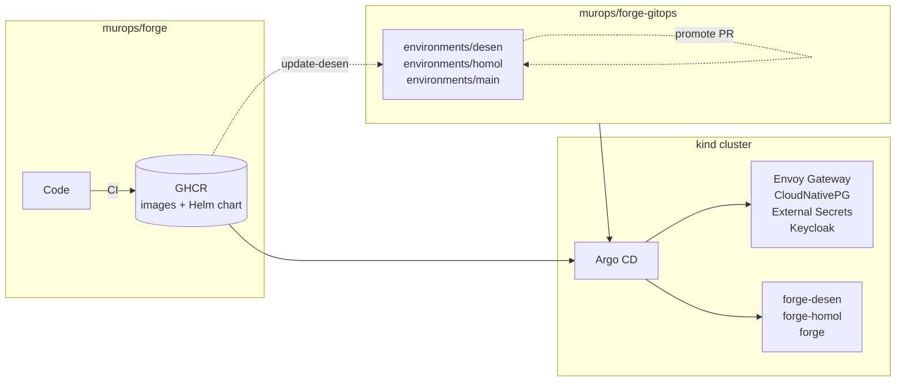

# forge-gitops

[](https://github.com/murops/forge-gitops/actions/workflows/ci.yml)

GitOps repository that runs [Forge](https://github.com/murops/forge) on Kubernetes with Argo CD: the platform it needs (gateway, Postgres operator, Keycloak, External Secrets) and three environments, `desen`, `homol` and `main`, promoted through pull requests.

Everything runs on a local kind cluster with one command. Nothing in this repository is a secret.

## How it fits together



- `scripts/up.sh` creates the cluster, installs Argo CD once and applies the root Application. From then on Argo CD manages everything, itself included.
- The root Application renders [apps/](apps), a small Helm chart with one Application per platform component and two ApplicationSets for Forge. Sync waves install the operators first, then their resources, then the environments.
- Each folder in [environments/](environments) becomes two Applications: `forge-<env>-deps` with the database and secrets (Kustomize) and `forge-<env>` with the Forge chart from GHCR. They are separate because the chart runs its migrations in a PreSync hook, which needs the database to exist first.
- The environments belong to the `forge` AppProject, which only accepts this repository and the Forge chart as sources and only deploys to the `forge` and `forge-*` namespaces. The platform apps stay in `default`, since operators need cluster-wide resources.

## Environments and promotion

| Environment | URL | Namespace | Follows |
| --- | --- | --- | --- |
| desen | http://desen.forge.localhost | `forge-desen` | every build of `main` in murops/forge |
| homol | http://homol.forge.localhost | `forge-homol` | promoted from desen |
| main | http://forge.localhost | `forge` | promoted from homol, 2 replicas and a standby database |

An environment is a folder, not a branch: `env.yaml` holds the chart version and `values.yaml` the image tag and sizing, on top of [common-values.yaml](environments/common-values.yaml).

- [update-desen](.github/workflows/update-desen.yml) runs every hour, resolves which `sha-*` tag the `main` image points to and commits it to desen.
- [promote](.github/workflows/promote.yml) is started by hand, copies the image tag and chart version one environment up and opens a pull request. Merging it is the deploy.

Both validate the rendered manifests before writing anything, and only use the workflow's own `GITHUB_TOKEN`.

## Secrets

The [External Secrets Operator](https://external-secrets.io) generates every secret inside the cluster:

- Keycloak's `forge-web` client secret is generated once in the `keycloak` namespace and injected into the realm import.
- Each environment gets its own `AUTH_SECRET` and copies the client secret through a `ClusterSecretStore` limited to the `forge*` namespaces.
- Database credentials are created by CloudNativePG.

On a real cluster the same ExternalSecrets would point to AWS Secrets Manager instead of the generator and the Kubernetes store.

## Running locally

Requires Docker, [kind](https://kind.sigs.k8s.io), kubectl and Helm. Port 80 on 127.0.0.1 must be free.

```bash
make up
```

The first sync takes about 5 minutes. `*.localhost` resolves to 127.0.0.1 in browsers, so no hosts file changes are needed.

| Service | URL | Login |
| --- | --- | --- |
| Forge | http://forge.localhost | `dev` / `dev` |
| Argo CD | http://argocd.localhost | `admin`, password printed by `make up` |
| Keycloak | http://keycloak.localhost | `admin`, password in the `keycloak-initial-admin` Secret |

`make validate` renders everything Argo CD would apply and checks it with kubeconform, and `make down` deletes the cluster. The CI runs the same validation and scans the rendered manifests with Trivy.

## Design decisions

- **One issuer URL for browsers and pods.** The API validates tokens against `http://keycloak.localhost/realms/forge`, the same URL the browser is redirected to. A CoreDNS rewrite sends `keycloak.localhost` to the Envoy service inside the cluster, so there is no split between internal and external Keycloak addresses.
- **Envoy Gateway on a fixed NodePort.** kind maps host port 80 to the NodePort on the control plane node, with `externalTrafficPolicy: Cluster` because Envoy runs on the workers. A NodePort Gateway never gets an address, so Argo CD checks its listeners instead of the `Programmed` condition.
- **Keycloak through its operator,** with the realm as a `KeycloakRealmImport` and its database on CloudNativePG, instead of a dev mode container.
- **Server-side diff in Argo CD,** so fields defaulted by the API server are not reported as drift.
- **External Secrets instead of Sealed Secrets.** Sealed Secrets are tied to a key in the cluster, which does not survive recreating a kind cluster, while generated secrets do not need to be in Git at all.

## Layout

```
apps/                 Helm chart rendered by the root Application
bootstrap/            kind config and Argo CD values, also used by Argo CD to manage itself
platform/gateway/     GatewayClass, Gateway and the Argo CD route
platform/keycloak/    Keycloak, its database and the forge realm
platform/external-secrets/  ClusterSecretStore for the client secret
environments/         base Kustomization, common values and one folder per environment
scripts/              up.sh and validate.sh
```
